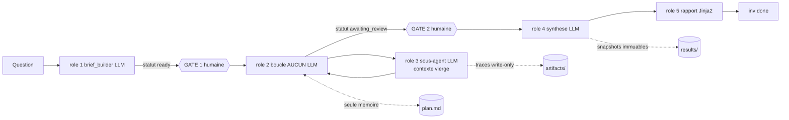

# investigator

**Moteur d'investigation qui répond à une question complexe en la décomposant en tâches atomiques, exécutées une par une dans un contexte LLM vierge, avec un fichier markdown pour seule mémoire.**


## Sommaire

- [Architecture](#architecture)
- [Documentation](#documentation)
- [Démarrage](#démarrage)
- [Exemple de bout en bout](#exemple-de-bout-en-bout)
- [Configuration](#configuration)
- [Commandes](#commandes)
- [Ce que gemma4:e4b a imposé](#ce-que-gemma4e4b-a-imposé-mesuré-pas-supposé)
- [Tests](#tests)
- [Structure du projet](#structure-du-projet)
- [Limites connues](#limites-connues)
- [Licences & composants](#licences--composants)

## Architecture

Vous posez une question complexe. Le système la découpe en tâches simples, écrites dans
un fichier markdown. Puis une boucle les exécute **une par une** : pour chaque tâche, un
appel LLM avec un **contexte vierge**, qui ne reçoit que cette tâche, rend son résultat,
et disparaît.

**Le fichier markdown est la seule mémoire du système.** Aucun état ne survit dans le
contexte d'un LLM entre deux tâches. Conséquence directe : le moteur est redémarrable par
construction — on peut le tuer en plein vol, `inv run` reprend à la première tâche
`pending`.

Deux points de contrôle humain sont obligatoires et **non contournables** : la liste de
tâches avant exécution, les résultats bruts avant synthèse.



| Rôle | Appelle un LLM ? | Ce qu'il fait |
|---|---|---|
| 1. `brief_builder` | Oui | Conversationnel, **une question à la fois**, produit la liste de tâches en JSON |
| 2. `loop` | **Non** | Relit le plan, prend la première tâche exécutable, commit, vérifie les arrêts |
| 3. `agent` | Oui | Une tâche, un contexte vierge, boucle d'outils bornée |
| 4. `synthesize` | Oui, une fois | Relit le logbook du disque, snapshot daté immuable |
| 5. `reporter` | **Non** | Jinja2 vers HTML |

Le system prompt du sous-agent est littéral : *« You execute exactly one task. You do not
summarize. You do not comment on other tasks. »*

> Détails : [docs/ARCHITECTURE.md](docs/ARCHITECTURE.md)

## Documentation

| Document | Contenu |
|---|---|
| [docs/CADRAGE.md](docs/CADRAGE.md) | Le **pourquoi** : objectifs, périmètre, hypothèses, décisions, stratégie de tests |
| [docs/ARCHITECTURE.md](docs/ARCHITECTURE.md) | Le **comment** : composants, flux, persistance, `ToolPack`, sécurité |
| [investigations/README.md](investigations/README.md) | Le registre des enquêtes menées |

## Démarrage

**Prérequis** : Python 3.12 et `uv`. Aucune base de données requise pour la démo.

```bash
uv sync
```

```bash
cp .env.example .env
```

### Le modèle : service LLM central, pas d'Ollama local

Ce projet **ne lance pas son propre Ollama**. Il consomme le service mutualisé
`~/mes_projets/llm-service` (conteneur `ollama-central`), qui expose un endpoint
OpenAI-compatible. C'est le cas « application `uv` locale » du guide
`llm-service/docs/brancher-un-projet.md`.

```bash
cd ~/mes_projets/llm-service && make up
```

```bash
cd ~/mes_projets/llm-service && make models
```

| Accès | URL | Note |
|---|---|---|
| Endpoint LLM (hôte) | `http://localhost:11434/v1` | Valeur par défaut du `.env` |
| Endpoint LLM (réseau `llm-net`) | `http://ollama-central:11434/v1` | Si ce projet est un jour conteneurisé |
| Rapport HTML | `investigations/<date>_<slug>/results/*_report.html` | Fichier local, à ouvrir dans un navigateur |

## Exemple de bout en bout

Le dépôt contient un corpus de démonstration dans `corpus/` : six notes markdown sur une
hausse de churn (comité produit, post-mortem de migration, entretiens de sortie, support,
veille concurrentielle, tickets critiques).

**1. Construire le brief** — le rôle 1 découpe par hypothèse, chaque tâche avec son
périmètre de fichiers. Le plan sort en statut `ready` : rien ne s'exécute encore.

```bash
uv run inv new "Pourquoi le churn des clients Entreprise a-t-il augmente au premier semestre 2026 ?" --yes
```

**2. GATE 1** — vous relisez et amendez. `--edit` ouvre `plan.md` dans `$EDITOR` ; le
frontmatter YAML est la source de vérité, donc vous pouvez y supprimer une tâche hors
sujet, resserrer un périmètre, réordonner. À la fermeture, le fichier est **revalidé
intégralement** : une dépendance vers une tâche inexistante est refusée immédiatement,
pas trois tâches plus tard.

```bash
uv run inv tasks pourquoi-le-churn-des-clients-entreprise --edit
```

**3. Lancer la boucle.**

```bash
uv run inv run pourquoi-le-churn-des-clients-entreprise
```

**4. GATE 2** — les résultats bruts, avant toute synthèse. Sans `approve`, `synthesize`
refuse de tourner : c'est une vérification de code, pas une convention.

```bash
uv run inv review pourquoi-le-churn-des-clients-entreprise
```

```bash
uv run inv approve pourquoi-le-churn-des-clients-entreprise --note "findings partielles assumees"
```

**5. Synthétiser, rapporter, clore.**

```bash
uv run inv synthesize pourquoi-le-churn-des-clients-entreprise
```

```bash
uv run inv report pourquoi-le-churn-des-clients-entreprise
```

```bash
uv run inv done pourquoi-le-churn-des-clients-entreprise
```

### Ce que ça donne réellement

Extrait d'un run réel sur ce corpus avec `gemma4:e4b`, chiffres non maquillés :

```
▶ t4 Analyser les tickets critiques pour identifier les défaillances systémiques
  done · 2 outil(s) · 4585 tokens · 28.3s
```

La finding correspondante cite de vrais numéros de tickets du corpus. Et la synthèse
liste explicitement ce qui **n'a pas** été établi :

> **Non établi**
> · L'impact concurrentiel n'a pu être évalué faute d'informations (t3).
> · Les tentatives d'identifier les problèmes récurrents (t1) ont échoué.

Une tâche bloquée reste visible partout — dans le plan, dans le rapport, dans les
*caveats* de la synthèse. Le système ne masque jamais ce qu'il n'a pas su faire.

## Configuration

Deux fichiers. Les secrets et l'adressage machine vont dans `.env`, interpolés dans
`config.yml` par `${VAR:-défaut}`. **Tout paramètre qui change le comportement du moteur
est visible dans [`config.yml`](config.yml)**, jamais enfoui dans le code.

### `.env`

| Variable | Défaut | Effet |
|---|---|---|
| `INV_LLM_BASE_URL` | `http://localhost:11434/v1` | Endpoint OpenAI-compatible du service central |
| `INV_LLM_MODEL` | `gemma4:e4b` | Modèle servi ; défaut universel du parc |
| `INV_LLM_API_KEY` | `ollama` | Ollama ignore la valeur, mais l'en-tête `Authorization` doit exister |

### `config.yml`

| Section | Paramètre | Défaut livré | Effet |
|---|---|---|---|
| `llm` | `structured_output` | `auto` | Tente `json_schema`, retombe sur le schéma injecté dans le prompt |
| `llm` | `max_validation_retries` | `3` | Retry à feedback sur erreur Pydantic. Ne pas descendre sous 3 |
| `llm` | `count_reasoning_tokens` | `true` | Ré-estime les tokens de raisonnement, non comptés par l'API |
| `llm` | `final_directive` | `true` | Ligne impérative finale ; sans elle, un modèle à raisonnement rend un contenu vide |
| `context` | `max_chars` | `4000` | Plafond du contexte passé au sous-agent |
| `context` | `include_dependencies` | `true` | Remonte l'`insight` des tâches de `depends_on` |
| `context` | `max_dependencies` | `10` | Nombre de dépendances remontées |
| `stop` | `strategy` | `none` | `none`, `llm` ou `callable` — évaluation du critère d'arrêt |
| `stop` | `callable` | `null` | `"mon_module:ma_fonction"` si `strategy: callable` |
| `agent` | `max_tool_calls` | `10` | Tours d'outils par tâche. Défaut du moteur : 5 |
| `agent` | `max_tokens` | `20000` | Budget d'une tâche entière |
| `agent` | `max_tokens_per_call` | `4096` | Plafond d'un seul appel |
| `loop` | `max_consecutive_blocked` | `2` | Circuit breaker |
| `loop` | `retry_blocked` | `false` | Rejouer les tâches bloquées |
| `toolpack` | `default` | `files` | Pack utilisé par `inv new` sans `--toolpack` |
| `toolpack.files` | `root` | `./corpus` | Racine du corpus investigué |
| `toolpack.sql` | `default_limit` | `1000` | `LIMIT` injecté si la requête n'en a pas |

## Commandes

| Commande | Rôle |
|---|---|
| `inv new "<question>" [--toolpack files] [--yes]` | Rôle 1 — construit la liste de tâches, statut `ready` |
| `inv tasks <slug> [--edit]` | **GATE 1** — affiche et permet d'éditer avant exécution |
| `inv run <slug> [--retry-blocked]` | Rôle 2 — la boucle |
| `inv step <slug>` | Une seule tâche, pour déboguer un prompt ou un toolpack |
| `inv status <slug>` | Tâches, budget, évaluations du critère d'arrêt |
| `inv review <slug>` | **GATE 2** — les findings brutes |
| `inv approve <slug> [--note]` | **GATE 2** — validation humaine explicite |
| `inv synthesize <slug>` | Rôle 4 — refuse sans `approve` |
| `inv report <slug>` | Rôle 5 — HTML, aucun LLM |
| `inv done <slug>` | Seule commande qui met le statut à `done` |
| `inv kill <slug> --reason "<...>"` | Abandonne l'enquête en gardant la trace du pourquoi |
| `inv list` | Toutes les investigations connues |

### Le pack `sql`

Le pack `sql` se branche **sans qu'une ligne du moteur ne change**, et lancer le moteur
sur `files` ne charge pas une ligne de code SQL.

```bash
uv sync --extra sql
```

## Ce que gemma4:e4b a imposé (mesuré, pas supposé)

Trois comportements constatés en run réel ont changé le code. Ils sont documentés parce
qu'ils se reproduiront avec **tout modèle à raisonnement**.

**1. Les tokens de raisonnement ne sont pas comptés** dans `usage.completion_tokens`.
Sans correction, le budget mentait d'un facteur ~4.
→ `llm.count_reasoning_tokens` les ré-estime.

**2. Le modèle « pense » et renvoie un contenu vide** — mesuré : `finish_reason: stop`,
746 caractères de raisonnement, 0 de contenu. Une dernière ligne impérative dans le
prompt le ramène à émettre le JSON ; un prefill assistant, non.
→ `llm.final_directive`. Sans effet sur un modèle qui n'en a pas besoin.

**3. Un `dict` libre dans un schéma ne se remplit pas.** Le champ `scope` d'une tâche
était un objet libre : `{"type": "object"}` dans le JSON Schema ne dit rien de ce qui est
attendu, et le modèle rendait `{}` sur **9 tâches sur 9**, même après trois retries à
feedback. La correction n'est pas un meilleur prompt : **c'est le pack qui déclare un
modèle typé** (`ToolPack.scope_model()`), et l'information est alors portée par la
génération elle-même.

**Corollaire, valable partout dans ce projet** : tout ce qu'un prompt seul n'obtient pas
d'un petit modèle doit passer par le **schéma**, où le retry à feedback peut le corriger.
Le nombre minimum de tâches, le format du périmètre, et le fait qu'un champ du brief
n'est pas une tâche sont trois règles portées par le schéma pour cette raison — chacune
ajoutée après un échec observé.

## Tests

```bash
uv run pytest
```

**171 tests, sans aucun LLM.** `FakeProvider` rend du JSON scripté et hérite du même
mécanisme de retry que le vrai provider : tester la boucle sans modèle teste aussi ce qui
rend un petit modèle exploitable.

| Propriété vérifiée | Test |
|---|---|
| 100 commits successifs, plan toujours valide | `test_cent_commits_successifs_gardent_le_plan_valide` |
| JSON invalide 2 fois puis valide, la tâche aboutit | `test_json_invalide_deux_fois_puis_valide` |
| Kill du process, relance au bon endroit | `test_kill_en_pleine_boucle_puis_relance_reprend_au_bon_endroit` |
| 2 blocked consécutifs, circuit breaker | `test_deux_blocked_consecutifs_ouvrent_le_circuit` |
| `validate` refuse, l'outil n'est pas exécuté | `test_un_refus_de_validate_n_execute_pas_l_outil` |
| `build_context` sans le logbook complet | `test_build_context_ne_contient_jamais_le_logbook_complet` |
| `files` tourne sans importer duckdb | `test_le_moteur_tourne_sur_files_sans_importer_duckdb` |
| La boucle ne contient aucun appel LLM (vérifié sur l'AST) | `test_la_boucle_ne_contient_aucun_appel_llm` |

> Détail par fichier : [docs/CADRAGE.md](docs/CADRAGE.md#8-stratégie-de-tests)

## Structure du projet

```text
test_2/
├── engine/
│   ├── schemas.py          # tout l'état persisté + les sorties structurées des LLM
│   ├── plan.py             # plan.md : écriture atomique, verrouillée, revalidée
│   ├── providers.py        # couche modèle + retry à feedback + FakeProvider
│   ├── config.py           # config.yml typé
│   ├── context.py          # build_context — la fonction critique, pure
│   ├── brief.py            # rôle 1
│   ├── loop.py             # rôle 2 — l'orchestrateur, AUCUN appel LLM
│   ├── agent.py            # rôle 3 — un sous-agent = une tâche
│   ├── synthesize.py       # rôle 4
│   ├── reporter.py         # rôle 5 — Jinja2
│   ├── cli.py              # la CLI inv, les deux gates humaines
│   ├── toolpacks/          # base.py, files.py, sql.py — le seul point de variation
│   └── templates/          # plan.md.j2, report.html.j2
├── investigations/
│   ├── README.md           # le registre
│   └── <date>_<slug>/
│       ├── plan.md         # la seule mémoire du système
│       ├── artifacts/      # traces write-only, jamais relues par un LLM
│       └── results/        # snapshots datés immuables
├── corpus/                 # le corpus de démonstration
├── docs/                   # CADRAGE.md (pourquoi) + ARCHITECTURE.md (comment)
├── tests/
├── config.yml              # les six paramètres explicites
└── .env.example
```

## Limites connues

- **`gemma4:e4b` bloque environ une tâche sur trois** sur ce corpus. Le moteur dégrade
  proprement — tâche `blocked`, raison inscrite, circuit breaker, reprise possible avec
  `--retry-blocked` — mais une enquête complète du premier coup demande un modèle plus
  gros. C'est une limite du modèle, pas du moteur : la même boucle avec `FakeProvider`
  est déterministe et verte.
- **Une tâche `blocked` bloque définitivement ses dépendantes** dans le run courant.
  C'est voulu : mieux vaut trois tâches non exécutées qu'une chaîne de raisonnement bâtie
  sur un maillon manquant. `inv status` les montre en `pending`.
- **Le rôle 1 en mode conversationnel n'a été testé qu'avec `FakeProvider`.** Tous les
  runs réels ont utilisé `--yes`. Le code existe, le parcours interactif n'a pas été
  éprouvé sur le vrai modèle.
- **Le pack `sql` n'a jamais tourné face à un vrai LLM.** Ses 27 tests couvrent la
  validation et l'exécution, mais aucun sous-agent réel ne l'a piloté.
- **Le compteur de blocages consécutifs** est propre au run courant, pas cumulé entre
  deux relances.
- **`artifacts/` n'est jamais purgé.**
- **Les artefacts visuels sont hors périmètre** : le champ `chart` existe et reste
  `null`. Voir [docs/CADRAGE.md](docs/CADRAGE.md#6-décisions) pour le point à trancher.

## Licences & composants

| Composant | Rôle | Licence |
|---|---|---|
| Python 3.12 | Langage | PSF-2.0 |
| uv | Gestion de paquets et d'environnement | MIT / Apache-2.0 |
| pydantic 2.13.4 | Schémas et validation | MIT |
| httpx 0.28.1 | Client HTTP | BSD-3-Clause |
| python-frontmatter 1.3.0 | Lecture/écriture du frontmatter | MIT |
| ruamel.yaml 0.19.1 | YAML round-trip | MIT |
| typer 0.27.0 | CLI | MIT |
| rich 15.0.0 | Affichage terminal | MIT |
| jinja2 3.1.6 | Templates (plan, rapport) | BSD-3-Clause |
| duckdb 1.5.5 | Base analytique, extra `sql` uniquement | MIT |
| pytest 9.1.1 | Tests | MIT |
| Ollama | Serveur LLM (service central mutualisé) | MIT |
| `gemma4:e4b` | Modèle | Gemma Terms of Use (Google) — pas une licence OSI |
| **Ce projet** | Code applicatif | MIT — Copyright (c) 2026 floSa |
