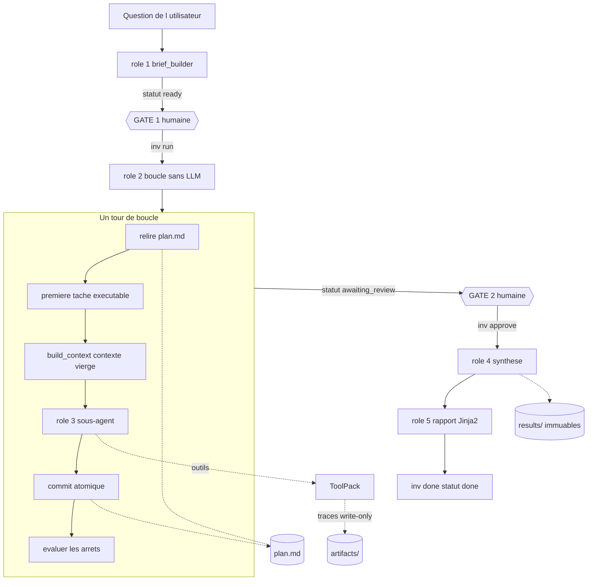
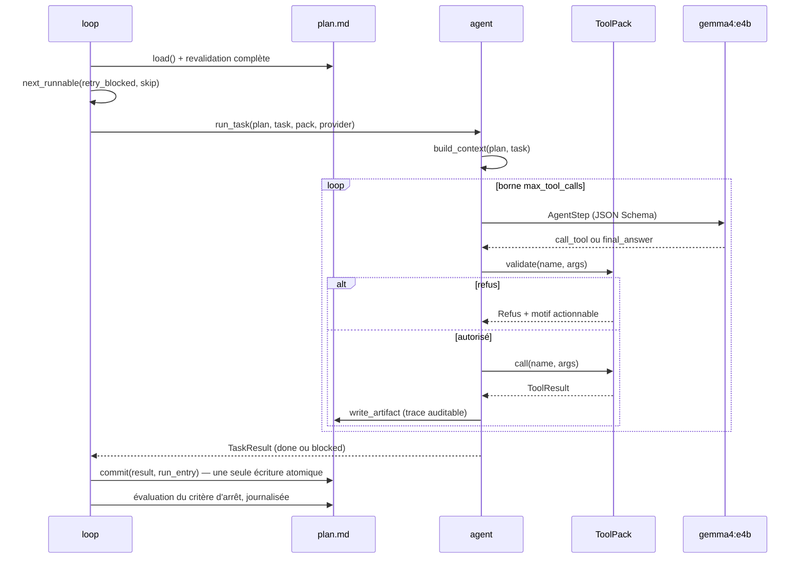

# Architecture — traceable-agent

Le **COMMENT**. Pour le **POURQUOI** (objectifs, hypothèses, décisions de cadrage),
voir [CADRAGE.md](CADRAGE.md).

---

## 1. Vue d'ensemble

Le système décompose une question complexe en tâches atomiques, puis les exécute une
par une. Chaque tâche est traitée par un appel LLM au **contexte vierge** : il ne reçoit
que sa tâche et un extrait minimal du plan, rend un résultat, et disparaît.

Un seul fichier porte l'état : **`plan.md`**. Aucun état ne survit dans le contexte d'un
LLM entre deux tâches. Trois conséquences directes :

- le moteur est **redémarrable par construction** — un `kill -9` en pleine boucle ne
  perd que la tâche en vol ;
- le contexte de chaque sous-agent est **borné et auditable** — on peut lire exactement
  ce qu'il a vu ;
- l'orchestrateur ne fait **aucun appel de modèle** : il enchaîne des lectures et des
  écritures de fichier.

---

## 2. Composants

Le projet n'a **pas de docker-compose** : c'est une application `uv` locale exposant une
CLI (`inv`), qui appelle un service LLM externe et mutualisé.

| Module | Rôle | Appelle un LLM ? |
|---|---|---|
| [`engine/schemas.py`](../engine/schemas.py) | Tout l'état persisté + les sorties structurées attendues des LLM | Non |
| [`engine/plan.py`](../engine/plan.py) | Lecture/écriture de `plan.md` : atomique, verrouillée, revalidée | Non |
| [`engine/config.py`](../engine/config.py) | `config.yml` typé + interpolation `.env` | Non |
| [`engine/providers.py`](../engine/providers.py) | Couche modèle, sortie structurée, retry à feedback, `FakeProvider` | Oui (c'est le seul client HTTP) |
| [`engine/context.py`](../engine/context.py) | `build_context` — décide ce qu'un sous-agent a le droit de savoir | Non (fonction pure) |
| [`engine/brief.py`](../engine/brief.py) | Rôle 1 — construit la liste de tâches | Oui |
| [`engine/loop.py`](../engine/loop.py) | Rôle 2 — l'orchestrateur | **Non, par construction** |
| [`engine/agent.py`](../engine/agent.py) | Rôle 3 — un sous-agent = une tâche + l'évaluation du critère d'arrêt | Oui |
| [`engine/synthesize.py`](../engine/synthesize.py) | Rôle 4 — synthèse finale, snapshot immuable | Oui, une fois |
| [`engine/reporter.py`](../engine/reporter.py) | Rôle 5 — rapport HTML | Non |
| [`engine/cli.py`](../engine/cli.py) | La CLI `inv` et les deux points de contrôle humain | Non |
| [`engine/checks/`](../engine/checks/) | La vérification chiffrée et la porte qui bloque | Non |
| [`engine/toolpacks/`](../engine/toolpacks/) | Le **seul** point de variation métier | Non |
| [`harness/`](../harness/) | Le banc de mesure (hors moteur) — voir [EVALUATION.md](EVALUATION.md) | Non |

---

## 3. Stack technologique

| Couche | Technologie | Version |
|---|---|---|
| Langage | Python | 3.12 |
| Gestion de paquets | uv | 0.11.28 |
| Validation / schémas | pydantic | 2.13.4 |
| Client HTTP | httpx | 0.28.1 |
| Frontmatter | python-frontmatter | 1.3.0 |
| YAML round-trip | ruamel.yaml | 0.19.1 |
| CLI | typer | 0.27.0 |
| Affichage terminal | rich | 15.0.0 |
| Templates | jinja2 | 3.1.6 |
| Base analytique (extra `sql`) | duckdb | 1.5.5 |
| Tests | pytest | 9.1.1 |
| Modèle | `gemma4:e4b` via le service central [`llm-service`](../../llm-service/) | endpoint `http://localhost:11434/v1` |

**Aucun framework d'agents.** La boucle fait **185 lignes** de code, lisibles d'un trait.

---

## 4. Flux de bout en bout

Le parcours complet, avec ses deux points de contrôle humain obligatoires :

1. `inv new "<question>"` — le rôle 1 interroge le modèle et produit une liste de tâches.
   Le plan est écrit en statut `ready`. **Rien ne s'exécute encore.**
2. **GATE 1** — l'humain relit (`inv tasks --edit`). Le frontmatter YAML est éditable ;
   toute édition est revalidée intégralement à la relecture.
3. `inv run` — la boucle relit le plan sur disque, prend la première tâche exécutable,
   instancie un sous-agent, commit le résultat, vérifie les arrêts, recommence.
   Fin de boucle : statut `awaiting_review`.
4. **GATE 2** — l'humain lit les findings brutes (`inv review`) puis `inv approve`.
   Sans cette approbation, `inv synthesize` refuse de tourner.
5. `inv synthesize` — un appel LLM sur le logbook relu du disque, snapshot daté et
   immuable dans `results/`.
6. `inv report` — Jinja2, aucun modèle.
7. `inv done` — seule commande qui met le statut à `done`. Humaine et explicite.



### Le tour de boucle, en détail



---

## 5. Persistance : le fichier est la base de données

### Format de `plan.md`

| Partie | Contenu | Relue par le code ? |
|---|---|---|
| Frontmatter YAML | **La source de vérité** : meta à plat, puis `brief:` et `logbook:` | Oui, exclusivement |
| Corps markdown | Vue humaine régénérée à chaque écriture ([`plan.md.j2`](../engine/templates/plan.md.j2)) | **Jamais** |

Le round-trip est donc sans perte, aucun LLM n'a besoin d'écrire du markdown, et un
humain peut éditer le YAML à la main entre deux runs.

### Garanties d'écriture

| Garantie | Mécanisme | Ce qu'elle évite |
|---|---|---|
| Atomicité | `mkstemp` + `fsync` + `os.replace` + `fsync` du répertoire | Un `plan.md` tronqué après un crash |
| Exclusion mutuelle | `flock` sur `.plan.lock` | Deux process qui s'écrasent |
| Intégrité du schéma | Revalidation Pydantic complète **avant** écriture et **après** lecture | Poser sur disque un état qui ne se relirait pas |
| Cohérence transactionnelle | `commit()` écrit finding + état + run_log **en une seule fois** | Une tâche `done` sans tokens comptés |
| Propreté | Balayage des temporaires orphelins de plus de 60 s | Des débris après un `SIGKILL` en pleine écriture |

### Arborescence d'une investigation

| Chemin | Contenu | Relu par un LLM ? |
|---|---|---|
| `plan.md` | La seule mémoire du système | Oui, **filtré par `build_context`** |
| `artifacts/` | Traces auditables : la commande shell, le SQL exact | **Jamais** — write-only |
| `results/` | Snapshots datés immuables (synthèses, rapports) | Non |

---

## 6. L'abstraction `ToolPack`

Le moteur ne connaît **aucun domaine métier**. La seule chose qui varie d'un usage à
l'autre est l'ensemble d'outils qu'un sous-agent peut appeler.

```python
class ToolPack(Protocol):
    name: str
    def describe(self) -> str                     # injecté au prompt
    def tools(self) -> list[ToolSpec]             # nom, schéma, doc
    def call(self, name, args) -> ToolResult
    def validate(self, name, args) -> Ok | Refus  # AVANT toute exécution
    def artifact(self, name, args, res) -> str | None   # trace auditable
```

Deux méthodes complémentaires servent le rôle 1 : `scope_hint()` (le format du périmètre
en prose) et `scope_model()` (le **schéma Pydantic** du périmètre — voir la décision
D-6 plus bas).

Un pack expose enfin `tables_produites` : les résultats **structurés** de ses appels,
au format `{"columns": [...], "rows": [[...]]}`. C'est sur eux, et jamais sur la prose
du modèle, que portent les contrôles de la section 7 bis. Un pack qui ne produit pas de
tableaux (`files`) laisse la liste vide.

### Les deux packs livrés

| Pack | Outils | Périmètre (`task.scope`) | Dépendance |
|---|---|---|---|
| `files` | `grep(pattern, glob)`, `read(path, start, end)`, `list(glob)` | `{"globs": [...]}` | Aucune |
| `sql` | `schema()`, `query(sql)` | `{"tables": [...]}` | `duckdb` (extra) |

### Garde-fous du pack `sql`

Tous appliqués par `validate()`, donc **avant** toute exécution :

| Garde-fou | Effet |
|---|---|
| Verbe autorisé | Refuse tout ce qui ne commence pas par `SELECT` ou `WITH` |
| Mots-clés interdits | `INSERT`, `UPDATE`, `DROP`, `ATTACH`, `COPY`, `PRAGMA`… |
| Fonctions fichier | Refuse `read_csv`, `read_parquet`, `glob`… qui contourneraient les tables déclarées |
| Tables déclarées | Refuse toute table absente de `task.scope["tables"]` (les CTE de la requête sont exclues du contrôle) |
| Instruction unique | Refuse un point-virgule au milieu |
| `EXPLAIN` préalable | duckdb valide syntaxe et colonnes ; son erreur devient le motif de refus |
| `LIMIT` injecté | Ajouté si absent (`default_limit`, 1000) |
| Connexion | Ouverte en `read_only` — défense en profondeur |
| Grain déclaré | Refuse de joindre un fait non agrégé au grain de la tâche (`aggregate_before_join`) |

Le **dictionnaire de la source** (`toolpack.sql.dictionary`) est injecté dans
`describe()`, donc **avant** la question et non en réponse à un outil. Un modèle qui
apprend au troisième tour que le e-commerce est une ligne de `stores` a déjà rendu son
top magasins.

Le contrôle de grain mérite d'être compris pour ce qu'il est. Il attrape le cas où une
requête n'utilise que des tables autorisées mais duplique une mesure par la jointure —
ce que l'allowlist ne voit pas. C'est de l'**analyse structurelle au niveau regex** :
elle reconnaît une forme de SQL, pas une sémantique. Une réécriture équivalente lui
échappe. **C'est un fil-piège, pas un théorème** ; la ligne de défense sur laquelle on
compte est le contrôle de valeur, section suivante.

### Isolation par import paresseux

`build_toolpack()` importe le module du pack **à la demande**. Lancer le moteur sur
`files` ne charge pas une ligne de code SQL, ni `duckdb`. Ce n'est pas une intention,
c'est un test qui vérifie `sys.modules` dans un process neuf après une investigation
complète.

---

## 7. Les six paramètres explicites

Le pattern d'origine laisse six points implicites. Chacun est un **réglage visible dans
[`config.yml`](../config.yml)**, jamais une constante enfouie.

| # | Point | Où | Réglages |
|---|---|---|---|
| 1 | Contexte du sous-agent | [`context.py`](../engine/context.py) | `context.max_chars`, `include_dependencies`, `include_watch_outs`, `include_question`, `max_dependencies` |
| 2 | Critère d'arrêt | [`loop.py`](../engine/loop.py) + [`agent.py`](../engine/agent.py) | `stop.strategy` (`none` / `llm` / `callable`), `stop.callable`, `stop.max_tokens` |
| 3 | Écriture du fichier | [`plan.py`](../engine/plan.py) | Invariant du moteur, sans réglage |
| 4 | Budget du sous-agent | [`agent.py`](../engine/agent.py) | `agent.max_tool_calls`, `agent.max_tokens`, `agent.max_tokens_per_call` |
| 5 | Artefacts visuels | Champ `chart` du schéma | Hors périmètre — voir [CADRAGE.md](CADRAGE.md#2-objectifs--périmètre) |
| 6 | Reprise après échec | [`loop.py`](../engine/loop.py) | `loop.retry_blocked`, `loop.max_consecutive_blocked` |

### Point 1 — ce que le sous-agent a le droit de savoir

`build_context(plan, task) -> str` est une **fonction pure** : ni disque, ni réseau, ni
horloge. Elle assemble trois choses, et rien d'autre :

1. la question globale, réduite à une phrase ;
2. les `watch_outs` du brief ;
3. pour chaque tâche de `depends_on`, **uniquement son champ `insight`**.

N'y entrent jamais : le logbook complet, les `summary`, les `influence`, les artefacts,
le run_log, les autres tâches. Un test plante un `summary` marqué CONFIDENTIEL dans le
logbook et exige qu'il ne fuite pas.

### Point 2 — l'arrêt est toujours journalisé

Quelle que soit la stratégie, l'évaluation laisse une entrée dans `logbook.stop_log` —
y compris en `none`, où le plan porte alors la trace explicite que le critère n'a jamais
été évalué. Un `callable` qui lève une exception ne casse pas l'enquête : il est
journalisé comme non concluant.

### Point 4 — le dépassement ne plante jamais

Budget d'outils épuisé, budget de tokens épuisé, provider injoignable, modèle qui ne
produit pas de JSON exploitable : tout se solde par une tâche `blocked` portant sa
raison. Les tokens brûlés par les tentatives ratées sont **quand même imputés** au
budget, pour qu'un modèle qui dérape ne dépense pas en douce.

### Point 6 — trois arrêts, tous vers `awaiting_review`

| Arrêt | Déclencheur |
|---|---|
| Budget | `plan.tokens_spent() >= budget_tokens_total` |
| Critère d'arrêt | La stratégie configurée retourne `fired=true` |
| Circuit breaker | `loop.max_consecutive_blocked` tâches bloquées d'affilée |

Aucun de ces arrêts ne clôt l'enquête : c'est un humain, via `inv done`, et lui seul.

---

## 7 bis. La vérification contraignante

Le point le plus important de cette couche tient en une phrase : **on ne demande pas au
modèle de se vérifier, on vérifie**.

La distinction n'est pas théorique. Le projet `data-analyst-agent` a essayé d'ajouter à
son prompt « si tu es loin de l'ordre de grandeur documenté, ta requête est fausse ».
Mesure faite : même requête naïve, même résultat, aucune auto-correction en deux essais.
La consigne a été retirée. Une consigne est indicative ; un contrôle est du code.

### Deux objets à ne pas confondre

| | `Task.sanity_check` | `Task.checks` |
|---|---|---|
| Nature | une phrase | des objets `Check` |
| Destination | le prompt du sous-agent | le code, après exécution |
| Porte sur | ce que le modèle devrait vérifier | le résultat **structuré** produit par l'outil |
| Pouvoir | aucun | **bloque la tâche** |

### Les quatre familles

| Famille | Ce qu'elle vérifie | Utilisable en production ? |
|---|---|---|
| `magnitude` | la valeur tient dans un intervalle plausible | **Oui** — n'exige aucune réponse de référence |
| `row_count` | le résultat a la taille attendue | Oui |
| `columns` | les dimensions demandées sont présentes | Oui |
| `expect_values` | des valeurs connues d'avance sont là | Non — réservé au banc de mesure |

Seul `expect_values` demande de connaître la réponse. Les trois autres se dérivent du
dictionnaire de la source ou de la forme attendue, donc protègent aussi une question
inédite.

### Trois issues, pas deux

Un contrôle rend `réussi`, `échoué`, ou **`non vérifiable`** — ce dernier quand la
grandeur contrainte n'est pas identifiable dans le résultat.

« Je n'ai pas pu vérifier » n'est ni un succès ni un échec. Les confondre ment dans un
sens (on accuse à tort) ou dans l'autre (on prétend une couverture qu'on n'a pas). Seul
un contrôle **applicable et échoué** bloque ; les non vérifiables sont comptés à part.

Cette nuance vient d'un vrai incident, décrit en D-9.

### La porte

`apply_gate` ([`engine/checks/verify.py`](../engine/checks/verify.py)) s'intercale entre
l'exécution d'une tâche et son écriture dans le plan. Elle vit là, et non dans la
boucle, pour que celle-ci reste sous 200 lignes — c'est une contrainte du cahier des
charges, et elle est vérifiée par un test.

Quatre propriétés en font une porte et non un ornement :

1. l'état écrit dans `plan.md` est `blocked`, donc `next_runnable` ne débloque **aucune**
   dépendante — un chiffre faux ne peut pas alimenter la suite ;
2. le rapport est persisté avec la valeur produite et l'intervalle attendu : le plan dit
   *pourquoi* ;
3. une tâche non `done` ne transmet à la synthèse **que** son état et son motif d'échec,
   jamais la prose que le modèle avait rédigée (voir D-8) ;
4. `checks.binding: false` évalue et journalise sans rien arrêter — utile pour mesurer
   ce que les contrôles attraperaient avant de les activer.

---

## 8. Couche modèle

### Contrat

```python
provider.complete(system, user, schema, max_tokens) -> (instance_validée, Usage)
```

Le retour est **toujours** une instance validée du schéma demandé, ou une
`ProviderError` après épuisement des tentatives.

### Sortie structurée

`response_format: json_schema` si le serveur l'accepte — c'est le cas du service central
— sinon bascule automatique et définitive sur le JSON Schema injecté dans le prompt.

### Le retry à feedback

Sur erreur de validation, le modèle reçoit **son erreur Pydantic exacte**, pas un reset :

```
Ta reponse precedente a ete REJETEE :
- champ `tasks.0.scope` : Field required
Reponds a nouveau, uniquement avec un objet JSON valide conforme au schema.
```

Il est implémenté **une seule fois**, dans `BaseProvider`. `FakeProvider` en hérite,
donc toute la suite de tests exerce le mécanisme réel sans consommer un token.

**Corollaire de conception, valable partout dans ce projet** : tout ce qu'un prompt seul
n'obtient pas d'un petit modèle doit passer par le **schéma**, seul endroit où le retry
à feedback peut le corriger.

---

## 9. Décisions d'architecture

Patron : problème → options → choix → justification contrastive → limite.

**D-1. Le frontmatter porte tout l'état, le corps markdown est une vue générée.**
Il fallait un fichier lisible par un humain **et** relisible sans perte par le code.
Options : parser le markdown du corps ; tout mettre en frontmatter ; deux fichiers
séparés. Choix : **frontmatter comme source de vérité unique** plutôt que parsing du
corps, **parce que** parser du markdown généré par un LLM est fragile et qu'on veut que
`inv tasks --edit` reste éditable à la main en YAML. *Limite* : le corps est réécrit à
chaque commit, donc toute annotation manuscrite qu'on y ajouterait serait perdue — les
notes humaines vont dans le frontmatter (`watch_outs`, `adjustments`).

**D-2. Écriture atomique et revalidation intégrale à chaque commit.**
Options : écrire en append (journal) ; écrire en place ; tmp + rename. Choix :
**tmp + `os.replace` + revalidation complète** plutôt qu'un append incrémental,
**parce que** la propriété recherchée est « le fichier sur disque est toujours un plan
valide », y compris après un `kill -9`. *Limite* : coût en O(taille du plan) à chaque
tâche — mesuré acceptable (100 commits successifs testés), mais ce ne serait pas le bon
choix pour des milliers de tâches.

**D-3. L'orchestrateur ne fait aucun appel de modèle.**
L'évaluation LLM du critère d'arrêt aurait pu vivre dans `loop.py`. Choix : **la placer
dans `agent.py`** plutôt que dans la boucle, **parce que** « la boucle ne contient aucun
prompt » est une propriété qu'on peut alors vérifier mécaniquement — un test parcourt
l'AST de `loop.py` et refuse tout appel `.complete(...)`, tout import de client HTTP,
toute constante de chaîne longue. *Limite* : `agent.py` porte deux responsabilités
(le sous-agent et l'évaluateur d'arrêt), au bénéfice d'une garantie testable.

**D-4. Le contexte du sous-agent est une fonction pure.**
Options : construire le contexte dans l'agent ; le passer par la config ; une fonction
isolée. Choix : **une fonction pure testable seule** plutôt qu'une construction diffuse
dans `agent.py`, **parce que** c'est le point le plus sensible du système (ce qui fuite
entre deux tâches) et qu'il doit être vérifiable sans lancer quoi que ce soit.
*Limite* : aucune identifiée.

**D-5. Import paresseux des toolpacks.**
Options : importer tous les packs au démarrage ; plugin system ; import à la demande.
Choix : **import dans `build_toolpack`** plutôt qu'en tête de module, **parce que** la
promesse « le moteur tourne sur `files` sans qu'aucune ligne de code SQL ne soit
chargée » devient alors vérifiable par un test sur `sys.modules`. *Limite* : une erreur
d'import d'un pack n'apparaît qu'à son premier usage, pas au démarrage.

**D-6. Le périmètre d'une tâche est typé par le pack, pas laissé en dict libre.**
Le champ `scope` est un dict libre dans le plan (le moteur ne doit pas connaître le
métier), mais il était aussi un dict libre dans le schéma présenté au rôle 1. Mesuré en
run réel : `{"type": "object"}` dans le JSON Schema ne dit **rien** de ce qui est
attendu, et `gemma4:e4b` rendait `{}` sur 9 tâches sur 9, même après trois retries.
Choix : **le pack déclare un modèle Pydantic** (`scope_model()`) qui est branché dans le
schéma de sortie du rôle 1, **plutôt qu'**une consigne en prose, **parce que**
l'information est alors portée par la génération elle-même, à chaque tâche. Le plan, lui,
reçoit le résultat re-sérialisé en dict : le moteur reste ignorant du métier.
*Limite* : un pack sans `scope_model()` retombe sur le dict libre, avec le même défaut.

**D-7. Une tâche n'est tentée qu'une fois par run.**
Sous `--retry-blocked`, une tâche qui rebloque restait éligible et se faisait
resélectionner indéfiniment (constaté en run réel). Choix : **un `skip` propre au run**
plutôt qu'un compteur de tentatives persisté, **parce que** la sémantique voulue est
« une relance donne une chance à chaque tâche », pas « on abandonne définitivement ».
*Limite* : le compteur de blocages consécutifs n'est pas cumulé entre deux relances.

**D-8. Une tâche bloquée ne transmet pas sa prose à la synthèse.**
Un résultat rejeté par un contrôle gardait son `summary`, et `render_logbook` le
passait au prompt de synthèse : le chiffre écarté parce qu'il était faux **revenait par
la bande**, où il redevenait citable. Options : ne rien changer (la synthèse est censée
être prudente) ; nettoyer les nombres ; ne transmettre que l'état. Choix : **ne
transmettre que l'état et le motif d'échec** plutôt que de compter sur la prudence du
modèle, **parce que** c'est ce qui donne son sens à la porte — bloquer un chiffre puis
le réinjecter ailleurs n'est pas bloquer. *Limite* : la synthèse perd le contexte de ce
que le modèle avait cru trouver ; c'est voulu, ce contexte est précisément non fiable.

**D-9. Un contrôle a trois issues, pas deux.**
Constaté en mesure réelle : le repère « lignes en rupture ~1,1 % », sans colonne
désignée, jugeait **tous** les nombres du résultat. La réponse juste en portait trois
(3041 lignes, 1,08 %, 42 066 €) ; le contrôle a vu 3041, l'a comparé à `[0,5 ; 2,0]` et
a **bloqué du travail correct**. C'est le pire mode de défaillance de ce dispositif : un
contrôle qui refuse le juste apprend à ignorer les blocages.
Options : durcir les bornes ; exiger un nom de colonne exact ; introduire une troisième
issue. Choix : **un motif de colonne, et une issue `non vérifiable`** plutôt qu'un nom
exact, **parce que** le modèle nomme ses colonnes librement (`taux`, `pct_rupture`,
`part`) et qu'un contrôle qu'on ne peut pas appliquer ne doit ni accuser ni rassurer.
*Limite* : un motif trop large rattraperait la mauvaise colonne ; le trou ne se rouvre
pas pour autant, car une affirmation chiffrée sans **aucune** donnée reste bloquée.

---

## 10. Sécurité

Pas de `SECURITY.md` séparé : la surface d'attaque est réduite (application locale,
lecture seule, pas de réseau entrant, pas de secret autre que l'adressage du LLM).

| Durcissement | Effet |
|---|---|
| `validate()` avant toute exécution | Un outil hors périmètre n'est jamais exécuté, pas seulement filtré après coup |
| Périmètre par tâche (`scope`) | Une tâche ne peut lire que les fichiers/tables que le plan lui a déclarés |
| Refus des chemins absolus et de `..` | Empêche la sortie de la racine du corpus |
| Résolution des symlinks | Un lien pointant hors racine est ignoré à l'énumération |
| duckdb en `read_only` | Défense en profondeur si `validate` était contourné |
| Refus des fonctions fichier SQL | `read_csv` et consorts contourneraient les tables déclarées |
| Troncature des résultats d'outils | `max_bytes`, `max_results` — borne ce qui remonte au modèle |
| Artefacts write-only | Une trace ne peut pas réinjecter de contenu dans un prompt |
| Secrets hors du code | `.env` gitignoré, interpolé dans `config.yml` par `${VAR:-défaut}` |

**Non traité** : le corpus est supposé de confiance. Un fichier hostile pourrait tenter
une injection de prompt via son contenu, remonté tel quel au sous-agent. Le périmètre par
tâche limite l'exposition mais ne l'annule pas.

---

## 11. Limites connues & pistes

| Aspect | Limitation / État | Recommandation |
|---|---|---|
| Taux de blocage | `gemma4:e4b` bloque environ une tâche sur trois sur le corpus de démo | Modèle plus gros, ou `agent.max_tool_calls` plus haut |
| Dépendantes d'une tâche bloquée | Ne s'exécutent jamais dans le run courant (voulu) | `inv run --retry-blocked` après correction |
| Blocages consécutifs | Compteur propre au run, non cumulé entre relances | Le persister dans le logbook si le besoin apparaît |
| Purge des artefacts | `artifacts/` n'est jamais nettoyé | Commande `inv prune` ou rotation par date |
| Passage à l'échelle | Réécriture complète du plan à chaque commit | Convient jusqu'à quelques dizaines de tâches |
| Artefacts visuels | Champ `chart` présent, toujours `null` | Voir [CADRAGE.md](CADRAGE.md#6-décisions) — le point dur est de décider qui produit le graphique |
| Injection de prompt | Le contenu du corpus est supposé de confiance | Assainir ou encadrer les résultats d'outils si le corpus devient non maîtrisé |
| Couverture des contrôles | Les bornes `magnitude` ne valent que ce que le dictionnaire documente — **5 questions sur 13** sur la base Maxizoo | Enrichir le dictionnaire ; c'est l'action la moins chère |
| Mode de défaillance visé | `magnitude` protège contre « le chiffre est aberrant ». Mesuré : le mode dominant est « **la grandeur demandée est absente** » | Brancher `columns` / `row_count`, dérivables sans connaître la réponse |
| Contrôle de grain | Analyse de forme au niveau regex : reconnaît la forme naïve, pas une réécriture équivalente | Le traiter comme un fil-piège, pas comme une garantie |
